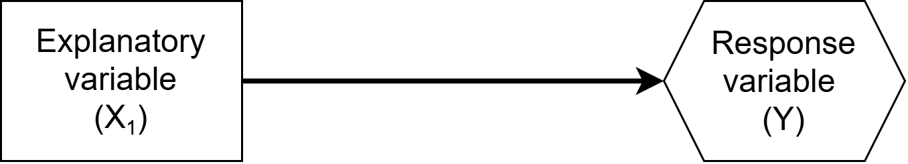
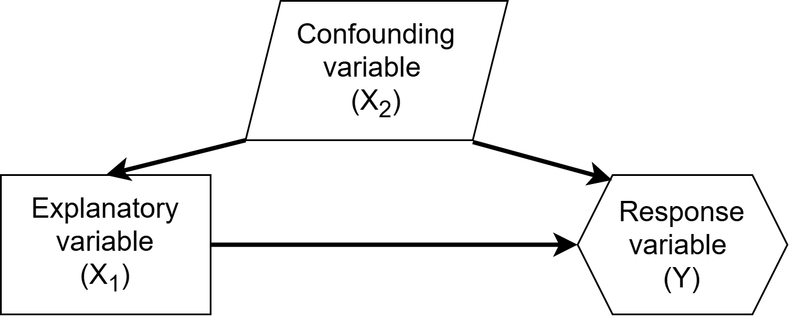
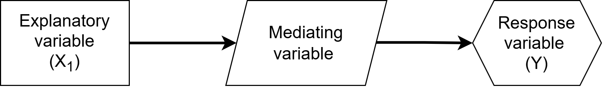
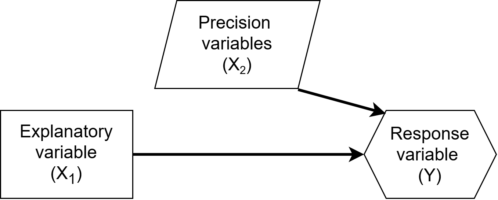
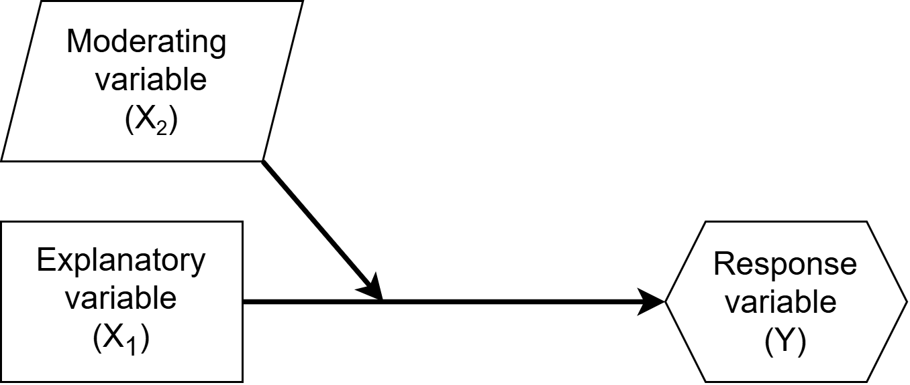

```{r}
#| echo: false

library(broom)
library(tidyverse)
theme_set(theme_bw(base_size = 24))
```

## After learning multiple linear regression...

The next natural questions are:

1. Does that change or add any assumptions to our model? (lec 7b)
2. What variables should I add as $X's$ in addition to my primary explanatory variable of interest?


# 2. Choosing $X$'s

| Goal | Guiding question | General Approach |
|:-----|:------------------|:------------------|
| Prediction | Which model predicts new outcomes most accurately? | *(next slide)* |
| Inference | What is the primary relationship of interest? | Prespecify model using research question & subject-matter knowledge |


## Model selection for prediction

Selecting a model for prediction requires evaluating how well candidate models perform on new observations. 

- *Techniques such as cross-validation, model selection, and regularization are beyond the scope of this course and are covered in Chapters 5 and 6 of ISL textbook and in MATH 398 and MATH 408.*

## Model selection for inference

Prespecification of your model = deciding on your model before looking at the data

- In observational studies, we interpret regression coefficients as adjusted associations
  - E.g., An expected change in $Y$ associated with a 1 unit increase in $X$
- Accounting for plausible confounders can strengthen a causal argument, but regression adjustment alone is insufficient to establish causation.

## Variable relationships

There are more types of relationships than just explanatory, response, and confounders

- The way that a variable is related the the explanatory and response variables dictates whether and how the additional variable should be included in our model, if at all

## Variables of primary interest



In study design our outcome of interest is our *response variable*, and our primary variable we think explains this variable is the *explanatory variable*.

Example: Sleep quality ($X_{1}$) affects academic achievement ($Y$)


## Variables of primary interest: what to do


- Choose a model appropriate for the variable type of the response $Y$
- Incorporate the explanatory variable as an $X_1$

## Confounding variables



- Are causally related to both the explanatory and response variable

Example: Stressful home environment can affect sleep quality and academic achievement

## Confounding variables: what to do


- are controlled for in experiments where there is random assignment of the explanatory variable / treatment
- need to be accounted for in observational studies (as an additional $X$)

## Mediating variables



- explain the process or mechanism of the relationship between the explanatory and response variables

Example: Sleep quality affects academic achievement through the mediator of alertness


## Mediating variables: what to do


- Should not be controlled for (added to model) because we would lose the relationship between $X$ and $Y$

## Precision variables



- Variables only related to response variable and not explanatory


## Precision variables: what to do


- Consider adding them to increase precision (reduce variable) of our estimates, if they are highly related to response variable


## Moderating variables



- Affects the strength or direction of the relationship between the explanatory and response variable
  - i.e., the slope relating $X_1$ to $Y$ differs depending on $X_2$
- Confounders can be moderating variables

Example: Would we expect an additional hour of sleep to have the same association with academic achievement for elementary school students and college students?


## Moderating variables: what to do


- Account for with an interaction between the moderating and explanatory variable
  - e.g. $Y_i = \beta_0 + \beta_1 X_{1i} + \beta_2 X_{2i} + \beta_3 X_{1i} X_{2i} +\epsilon_i$
  
## Example

Suppose we want to infer the relationship between bill length and bill depth 
```{r}
ggplot(penguins, aes(x = bill_dep, y = bill_len)) +
  geom_point() 
```

  
## Example Model 1

```{r}
penguin_model1 <- lm(bill_len ~ bill_dep, data = penguins)
tidy(penguin_model1)
```

```{r}
#| echo: false
penguin_model1_df <- tidy(penguin_model1)
beta1_0_hat <- filter(penguin_model1_df, term == "(Intercept)") |> 
  pull(estimate) |> 
  round(1)
beta1_1_hat <- filter(penguin_model1_df, term == "bill_dep") |> 
  pull(estimate) |> 
  round(1)
```

My fitted model 1 is:
$$\widehat{\text{Bill Length}}_i = `r beta1_0_hat` `r beta1_1_hat` \times \text{Bill Depth}_i$$

## Example model 1

```{r}
ggplot(penguins, aes(x = bill_dep, y = bill_len)) +
  geom_point() +
  geom_smooth(method = "lm")
```

## Example Model 2

This data is not from an experiment, so we have to consider confounding.

```{r}
ggplot(penguins, aes(x = bill_dep, y = bill_len, color = species)) +
  geom_point()
```


## Example Model 2

```{r}
penguin_model2 <- lm(bill_len ~ bill_dep + species, data = penguins)
tidy(penguin_model2)
```


```{r}
#| echo: false
penguin_model2_df <- tidy(penguin_model2) |> 
  mutate(estimate = round(estimate, 1))
beta2_0_hat <- filter(penguin_model2_df, term == "(Intercept)") |> 
  pull(estimate) 
beta2_1_hat <- filter(penguin_model2_df, term == "bill_dep") |> 
  pull(estimate) 
beta2_2_hat <- filter(penguin_model2_df, term == "speciesChinstrap") |> 
  pull(estimate) 
beta2_3_hat <- filter(penguin_model2_df, term == "speciesGentoo") |> 
  pull(estimate) 
```


My fitted model 2 is:
\begin{equation*}
  \begin{split}
    &\widehat{BillLength}_i\\
    &= `r beta2_0_hat` `r beta2_1_hat` \times BillDepth_i\\
    & + `r beta2_2_hat` \times I(Species = Chinstrap)\\
    &+ `r beta2_3_hat` \times I(Species = Gentoo)
  \end{split}
\end{equation*}

## Example Model 2

```{r}
penguins |> 
  modelr::add_predictions(penguin_model2) |> 
ggplot(aes(x = bill_dep, y = bill_len, color = species)) +
  geom_point() +
  geom_line(aes(y = pred))
```

## Example Model 3

Maybe the relationship between bill length and bill depth differs by species (i.e. maybe species is a moderating variable)

```{r}
ggplot(penguins, aes(x = bill_dep, y = bill_len, color = species)) +
  geom_point()
```

## Example Model 3


```{r}
penguin_model3 <- lm(bill_len ~ bill_dep * species, data = penguins)
tidy(penguin_model3)
```

## Example Model 3

```{r}
#| echo: false
penguin_model3_df <- tidy(penguin_model3) |> 
  mutate(estimate = round(estimate, 1))
beta3_0_hat <- filter(penguin_model3_df, term == "(Intercept)") |> 
  pull(estimate) 
beta3_1_hat <- filter(penguin_model3_df, term == "bill_dep") |> 
  pull(estimate) 
beta3_2_hat <- filter(penguin_model3_df, term == "speciesChinstrap") |> 
  pull(estimate) 
beta3_3_hat <- filter(penguin_model3_df, term == "speciesGentoo") |> 
  pull(estimate) 
beta3_4_hat <- filter(penguin_model3_df, term == "bill_dep:speciesChinstrap") |> 
  pull(estimate) 
beta3_5_hat <- filter(penguin_model3_df, term == "bill_dep:speciesGentoo") |> 
  pull(estimate) 
```


My fitted model 2 is:
\begin{equation*}
  \begin{split}
    &\widehat{BillLength}_i\\
    &= `r beta3_0_hat` `r beta3_1_hat` \times BillDepth_i\\
    &+ `r beta3_2_hat` \times I(Species = Chinstrap)\\
    &+ `r beta3_3_hat` \times I(Species = Gentoo)\\
    &+ `r beta3_4_hat` \times BillDepth_i \times I(Species = Chinstrap)\\
    &+ `r beta3_5_hat` \times BillDepth_i \times I(Species = Gentoo)
  \end{split}
\end{equation*}

## Example Model 3

```{r}
ggplot(penguins, aes(x = bill_dep, y = bill_len, color = species)) +
  geom_point() +
  geom_smooth(method = "lm")
```

## Example Model 3

- For every 1 mm increase in bill depth, a Chinstrap penguin's bill length is expected to change by an additional `r beta3_4_hat` millimeters compared to an Adelie penguin.
- For every 1 mm increase in bill depth, a Gentoo penguin's bill length is expected to change by an additional `r beta3_5_hat` millimeters compared to an Adelie penguin.

*What type of test could I do to test if there should be an interaction between bill depth and species?* \

. . .

**Partial f-test**
